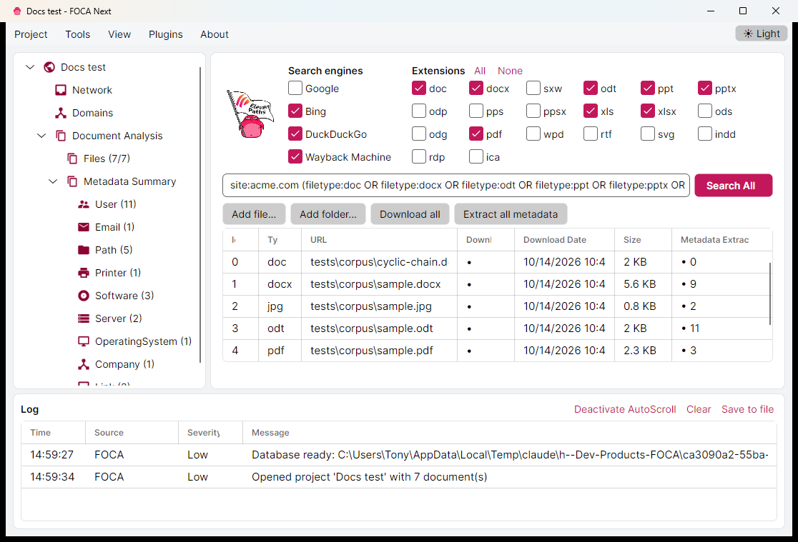
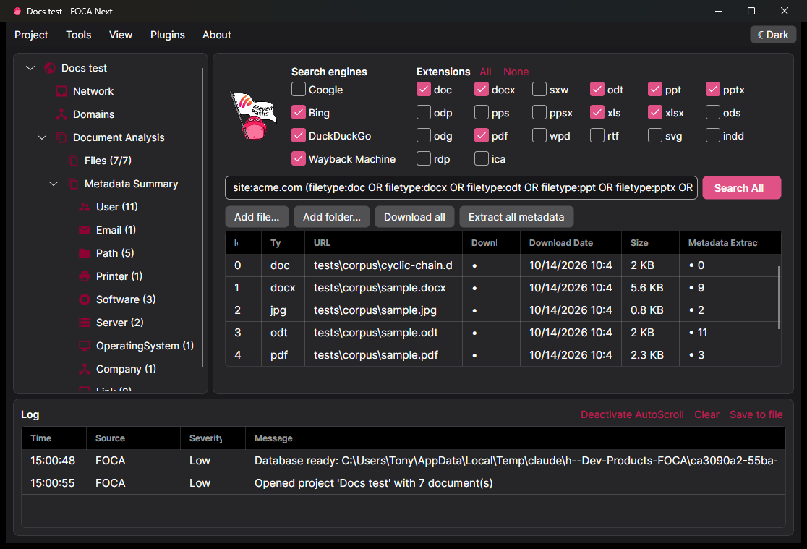

<div align="center">

# FOCA Next

**Fingerprinting Organizations with Collected Archives — rebuilt for Windows, Linux and macOS.**

FOCA Next is a cross-platform fork and rewrite of [FOCA](https://github.com/ElevenPaths/FOCA),
the classic OSINT tool for finding metadata and hidden information in documents.
The original FOCA has been unmaintained since 2021 and runs only on Windows with SQL Server;
FOCA Next modernises it into a portable application, a command-line tool and a reusable library.

[](https://github.com/Vibe-Coding-Base/FOCA-Next/actions/workflows/ci.yml)
[](https://github.com/Vibe-Coding-Base/FOCA-Next/releases)
[](LICENSE)




</div>

> **Legal note.** FOCA Next is for authorised security testing, OSINT research and educational use.
> Only analyse documents and domains you own or have permission to assess, and respect the terms of
> service and rate limits of any third-party service you query.

---

## Table of contents

- [Why FOCA Next](#why-foca-next)
- [What's different from the original FOCA](#whats-different-from-the-original-foca)
- [Features](#features)
- [Install](#install)
- [Quick start](#quick-start)
  - [Document analysis (no domain needed)](#document-analysis-no-domain-needed)
  - [Domain reconnaissance](#domain-reconnaissance)
- [Screenshots](#screenshots)
- [Build from source](#build-from-source)
- [Documentation](#documentation)
- [Security](#security)
- [Roadmap](#roadmap)
- [Contributing](#contributing)
- [License and credits](#license-and-credits)

## Why FOCA Next

The original FOCA is a great tool, but it is tied to Windows Forms, .NET Framework and a local
SQL Server instance, and it stopped receiving updates in 2021. Getting it to run today is often the
hardest part. FOCA Next keeps what made FOCA useful — the document metadata extraction and the
project-based workflow — and rebuilds everything around it:

- **Runs anywhere.** One codebase for Windows, Linux and macOS.
- **No database to install.** Projects live in a single SQLite file by default.
- **Scriptable.** A full command-line tool (`foca-cli`) alongside the desktop app.
- **Safer.** The document parsers are hardened against hostile files, and dependencies are current.
- **Still familiar.** The desktop app keeps FOCA's layout and workflow.

## What's different from the original FOCA

| | Original FOCA | **FOCA Next** |
|---|---|---|
| Operating systems | Windows only | **Windows, Linux, macOS** |
| Runtime | .NET Framework 4.x (WinForms) | **.NET 10** (Avalonia UI) |
| Database | SQL Server required | **SQLite by default**, SQL Server optional |
| Command line | — | **`foca-cli`** (analyze, search, export, import) |
| Projects without a domain | Workaround (fake domain) | **First-class "Document analysis" mode** |
| Document sources | Google, Bing, DuckDuckGo | + **Internet Archive (Wayback)**, pluggable providers |
| Subdomains | DNSDumpster scraping | **Certificate Transparency (crt.sh)** |
| Server inspection | HTTP/SMTP/FTP banners | + **TLS inspection** (protocol, cert, SAN), **security headers** |
| Reports | In-app tree | **HTML / JSON / CSV** export (and CLI) |
| Plugin API | WinForms-bound | **UI-neutral API v2**, isolated & approval-gated loading |
| Theme | Fixed | **Light / dark / system**, remembered |
| Document parsers | — | **Hardened** against XXE, zip/gzip bombs, ReDoS, huge allocations |
| Dependencies | Several outdated / vulnerable | **Current**, build fails on known vulnerabilities |
| Appearance | — | Updated, brand-consistent UI |

The original Windows application is preserved under [`legacy/`](legacy/) as **FOCA Classic** and still
builds, so Windows-only features that are not yet ported (active DNS reconnaissance, the backups
fuzzer, the v1 plugins) remain available.

## Features

- **Document metadata extraction** from Microsoft Office (97–2003 and OOXML), OpenDocument, PDF,
  images (EXIF/XMP, with embedded images), SVG/SVGZ, Adobe InDesign, RDP and ICA files.
- **Metadata summary** across a project: users, e-mails, paths, printers, software, servers,
  operating systems, companies and more — with spelling variants grouped together
  (`ACME\jdoe`, `jdoe@acme.com`, `JDoe`).
- **Document discovery** via Google, Bing, DuckDuckGo and the Internet Archive, with optional
  Google Programmable Search / Bing API keys.
- **Download and analyse** found documents, de-duplicated by content hash, in parallel.
- **Domain reconnaissance**: subdomains from Certificate Transparency, TLS and HTTP fingerprinting.
- **Reports** in HTML, JSON and CSV.
- **Plugins** (API v2) that add commands, panels and analyzers.
- **Import** projects from the original FOCA's SQL Server database.

## Install

Download the archive for your platform from the
[**Releases**](https://github.com/Vibe-Coding-Base/FOCA-Next/releases) page and extract it. Each archive
contains two self-contained programs — no .NET installation required:

- `FOCA` / `FOCA.exe` — the desktop application.
- `foca-cli` / `foca-cli.exe` — the command-line tool.

| Platform | Archive |
|---|---|
| Windows x64 / arm64 | `FOCA-Next-<version>-win-x64.zip` / `-win-arm64.zip` |
| Linux x64 / arm64 | `FOCA-Next-<version>-linux-x64.tar.gz` / `-linux-arm64.tar.gz` |
| macOS Intel / Apple Silicon | `FOCA-Next-<version>-osx-x64.tar.gz` / `-osx-arm64.tar.gz` |

Verify downloads against `SHA256SUMS`. On macOS the app is not yet notarised, so Gatekeeper will
require right-click → Open the first time.

## Quick start

### Document analysis (no domain needed)

FOCA Next can analyse a folder of documents directly — no domain, no searching.

```sh
# Report to the console
foca-cli analyze ./documents --recursive

# Save the results in a project and export an HTML report
foca-cli analyze ./documents -r --project "Audit 2026"
foca-cli export "Audit 2026" --format html --output report.html
```

In the desktop app, choose **Document analysis** when creating a project and point it at a folder.

### Domain reconnaissance

```sh
foca-cli project create "ACME" --domain acme.com
foca-cli search "ACME" --wayback --download     # find + download + analyse documents
foca-cli project show "ACME"                     # metadata summary
foca-cli export "ACME" -f html -o acme.html
```

Add API keys for Google Programmable Search / Bing / Shodan in **Tools → Options** (desktop) or pass
`--api-key` / `--google-cx` to `foca-cli search`.

Import projects from the original FOCA:

```sh
foca-cli import-legacy --connection "Server=.\SQLEXPRESS;Database=Foca;Integrated Security=true;TrustServerCertificate=true"
```

See the [CLI reference](docs/cli.md) for all commands.

## Screenshots

| Light | Dark |
|---|---|
|  |  |

## Build from source

Requires the [.NET 10 SDK](https://dotnet.microsoft.com/download). On Windows, building FOCA Classic
additionally needs Visual Studio 2022+ or the Build Tools with the .NET desktop workload.

```sh
git clone https://github.com/Vibe-Coding-Base/FOCA-Next.git
cd foca-next

# Build and test everything (FOCA Classic too, on Windows)
./build.ps1

# Produce self-contained packages
./build/publish.ps1 -Runtime linux-x64 -Version 1.0.0
```

The cross-platform solution is `Foca.slnx`; FOCA Classic is `legacy/FOCA.Classic.slnx`.
See [docs/architecture.md](docs/architecture.md) for the project layout.

## Documentation

- [CLI reference](docs/cli.md)
- [Writing plugins](docs/plugins.md)
- [Architecture and project layout](docs/architecture.md)
- [Security model](SECURITY.md)
- [Changelog](CHANGELOG.md)

## Security

FOCA Next analyses documents from untrusted sources, so the parsers are built defensively: XML is
parsed without DTDs or external entities, archives are read with size caps, structure lengths are
validated before allocating, and regexes have timeouts. Package vulnerabilities fail the build.
See [SECURITY.md](SECURITY.md) for the threat model and how to report a vulnerability.

## Roadmap

- Port the remaining FOCA Classic modules where they make sense cross-platform (passive DNS: SPF,
  DMARC, MX; network/servers map).
- Installers (MSIX, AppImage, `.deb`, notarised `.dmg`) and auto-update.
- A Windows compatibility shim to host selected v1 plugins.

Active reconnaissance modules from the original FOCA (wordlist subdomain brute-force, DNS zone
transfer attempts, DNS cache snooping, the backups fuzzer) are intentionally **not** ported to the
cross-platform app; they remain in FOCA Classic.

## Contributing

Contributions are welcome — see [CONTRIBUTING.md](CONTRIBUTING.md). In short: open an issue to
discuss larger changes, keep `./build.ps1` green, and add tests for new behaviour.

## License and credits

FOCA Next is licensed under the [GNU GPL v3](LICENSE).

It is based on [FOCA](https://github.com/ElevenPaths/FOCA) by **ElevenPaths** (Telefónica Tech),
also GPL v3. FOCA Next is an independent fork and is not affiliated with or endorsed by
Telefónica Tech.

Maintained by **Tony**.
